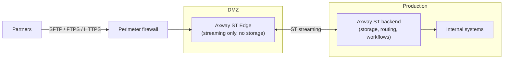
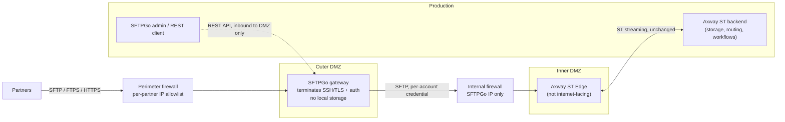
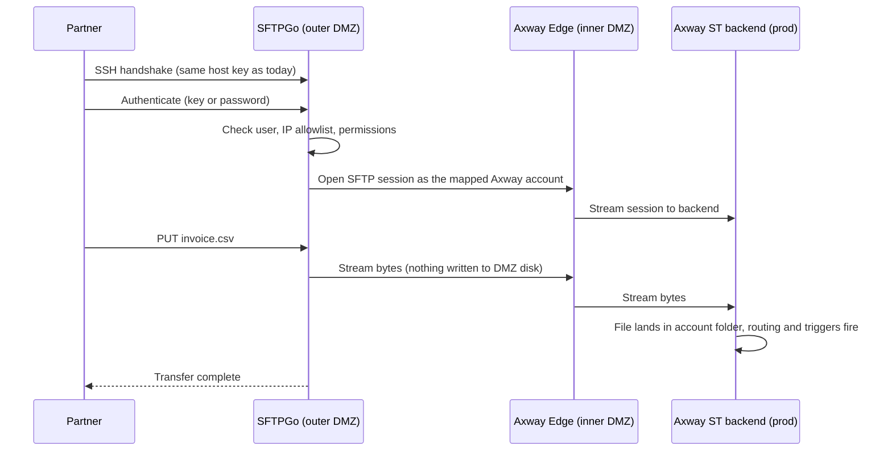
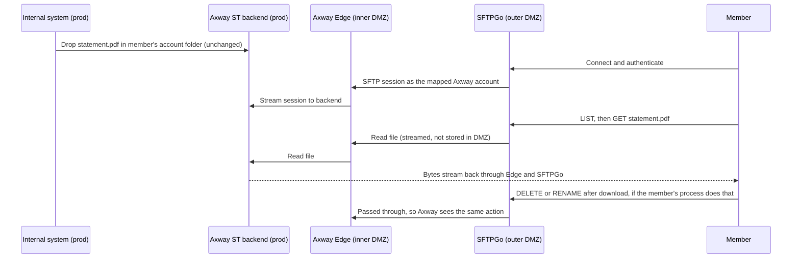
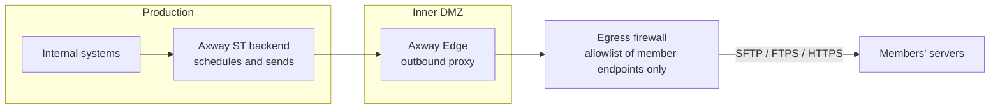
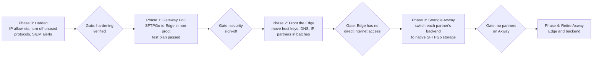
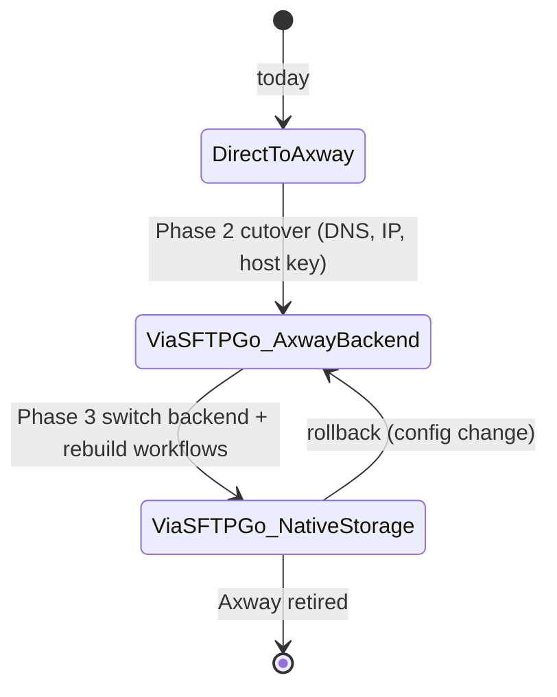
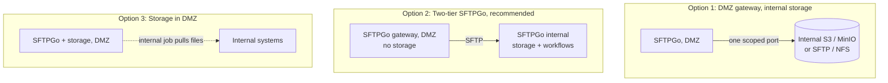

# Proposal: Fronting Axway Edge with SFTPGo

Nov 11, 2026 · @Jugash Chandarlapati

## Summary

We propose putting SFTPGo in an outer DMZ as a protocol-terminating gateway in front of the Axway SecureTransport Edge. Unsupported Axway software then stops facing the internet directly.

- **Problem:** the Axway Edge is internet-facing and Axway is no longer supported. A future pre-auth CVE in its SSH, TLS or HTTP stack could not be patched.
- **Proposal:** SFTPGo completes the partner's SSH/TLS session and authentication. It then opens its own SFTP session to the Axway Edge, which streams to the ST backend as it does today. Axway only ever talks to SFTPGo.
- **Why SFTPGo:** it is already our long-term replacement. The same gateway lets us move partners off Axway one at a time, so the de-risking work is also the first phase of the migration.
- **What stays the same:** partners keep the same DNS name, IP and host key. Axway routing and file-arrival triggers are unchanged. No files are stored in the DMZ. Members collect published files the same way; pushes to members' servers get egress controls now and a replacement plan before Phase 3.
- **Decisions needed:** approval for the outer DMZ segment and firewall rules, and agreement on the long-term DMZ pattern for SFTPGo (see Open questions).

## Current state

Today partners connect straight to the Axway Edge in the DMZ. The Edge stores nothing; it streams each session to the ST backend in production, where files land and workflows run.

- The Edge is the only Axway component reachable from the internet.
- Which side opens the Edge-to-backend streaming connection needs confirming. It decides which firewall rule our security team already accepts for DMZ-to-production traffic.
- Outbound transfers (Axway pushing files to partners) also leave through the DMZ.

## Problem and risk

The main risk is a pre-authentication vulnerability in Axway's internet-facing protocol stack that we cannot patch because the product is out of support.

- **Exposure:** any internet host can start an SSH or TLS handshake with the Edge before it is authenticated. Recent issues across the industry, such as the Terrapin SSH attack and the MOVEit, GoAnywhere and Cleo exploits, show managed file transfer is a favoured target.
- **No vendor fix:** without support, a disclosed CVE would leave us choosing between running exposed and shutting off partner traffic.
- **Timeline:** full migration to SFTPGo will take time. We need a control that reduces exposure now and does not slow the migration.

## Options considered

Only an option that terminates the protocol takes Axway's SSH and TLS stack out of the internet-facing path. Passthrough options help, but not against the risk we are trying to remove.

| Option | Examples | Ends partner session before Axway? | Fit with migration | Verdict |
| --- | --- | --- | --- | --- |
| A. Hardening only | Per-partner IP allowlists, disable unused protocols and ciphers | No | Neutral | Do now, whatever we choose |
| B. TCP (L4) passthrough | HAProxy or NGINX stream, F5 LTM, firewall NAT | No; Axway still handles the handshake | Neutral | Adds rate limits only; not enough |
| C. SFTPGo gateway | SFTPGo with a remote-SFTP storage backend pointed at the Axway Edge | Yes | Strong; it is the target platform | **Recommended** |
| D. Commercial reverse proxy | JSCAPE MFT Gateway | Yes | Weak; another product to buy and later retire | Fallback if we need vendor support |
| E. Vendor-specific gateway | GoAnywhere Gateway, MOVEit Gateway | Not applicable | None; they front only their own products | Rejected |
| F. WAF for HTTPS | F5 ASM, NGINX with ModSecurity | Yes, for HTTPS only | Neutral | Use if partners rely on the Axway web client |

MFT gateways have been exploited heavily themselves. Whatever sits on the edge should be minimal, memory-safe where possible and patched quickly. SFTPGo is written in Go and has a small footprint and frequent releases.

## Recommended design

SFTPGo sits in a new outer DMZ segment and takes over the Edge's public DNS name, IP and host keys. Each partner account in SFTPGo uses a remote-SFTP storage backend that points at the matching account on the Axway Edge.

The Edge has no storage, and it does not need any for this design. SFTPGo connects to the Edge's SFTP listener as an ordinary SFTP client, the same way partners do today. The Edge streams to the backend, so files still land in the same Axway account folders.

- **Accounts:** one SFTPGo user per Axway account, so routing and post-processing are unchanged.
- **Credentials:** partner keys and passwords move to SFTPGo. SFTPGo holds each Axway account's credential, encrypted with a KMS. Client credentials cannot be passed through.
- **Identity:** the Edge's SSH host keys and FTPS/HTTPS certificates move to SFTPGo, so partners see no change.
- **Protocols:** SFTPGo handles SFTP, SCP, FTP/S, HTTPS and WebDAV. AS2, PeSIT and other Axway-specific protocols need a separate path.

## Outbound: publishing files to members

We also publish files from inside the firm to members. How this works depends on who opens the connection. Members collecting files (pull) work through the gateway with no extra design. Axway pushing files to members' servers (push) does not pass through the gateway and needs its own controls.

### Pull: members download from their mailbox

Internal systems drop files into the member's Axway account as they do today. The member collects them through SFTPGo, which reads them from the Edge and backend over SFTP.

- No new firewall rules. The member connection is the same inbound path as uploads.
- Check any Axway behaviour that depends on the download itself: delete-after-download, archive or move on download, "downloaded" status flags, and arrival notifications sent to members. These should still fire because Axway sees a normal SFTP download, but each needs a Phase 1 test.
- Large directory listings and many small files add latency across the extra hop. Include a heavy-mailbox member in the performance test.

### Push: Axway delivers to members' servers

If Axway opens outbound connections to members' SFTP, FTPS or HTTPS endpoints, the inbound gateway does not change that path. The risk is lower than inbound: Axway connects only to known hosts and no stranger can start a session with it. It is still unsupported software on the internet, though, and a malicious or compromised member server could attack Axway's client code.

- **Now:** limit egress from the Edge to an explicit allowlist of member hosts and ports. Pin member host keys and certificates in Axway. Log every outbound transfer to the SIEM.
- **Gap for the long term:** SFTPGo is mainly a server. Its event manager can run actions when files arrive or on a schedule, but it is not a full push engine with retries, per-member schedules and delivery receipts like Axway. Before Phase 3 we need to choose how pushes will work, for example SFTPGo event actions calling a transfer tool such as rclone, or a small scheduler, or moving those members to pull.
- **Migration:** push members can stay on Axway until that choice is made. Pull members move first.

## Security properties and constraints

The design keeps today's two promises: no files at rest in the DMZ, and no new connections from the DMZ into production.

| Property | How it is met |
| --- | --- |
| Axway not internet-facing | Only SFTPGo's IP can reach the Edge; the perimeter firewall forwards to SFTPGo only |
| No data at rest in the DMZ | Remote-SFTP backend streams through; no local, home or cache storage on the SFTPGo node; temp directory monitored |
| No new DMZ-to-production connections | SFTPGo connects only to the Edge, which is also in the DMZ; the existing Edge-to-backend link is unchanged |
| Data plane separate from management plane | WebAdmin turned off on public listeners; SFTPGo uses a local data provider in the DMZ; management happens from production over the REST API (connections from production into the DMZ only) |
| Least exposure | Per-partner source IP allowlists in SFTPGo and on the firewall; unused protocols and weak ciphers turned off |
| Detection | SFTPGo and Edge logs sent to the SIEM; alerts on failed-auth spikes and new source IPs |
| Recovery | SFTPGo node built from code and configuration so it can be rebuilt quickly; config and user export backed up |

## Migration and phasing

We de-risk first, then move partners off Axway one at a time behind the same gateway. Each phase has a gate before the next one starts. Dates will be set once the open questions are answered.

In Phase 3, each partner moves with a configuration change in SFTPGo. Their connection details stay the same, and we can switch back per partner.

### Long-term target state

After Axway is retired, SFTPGo has no built-in equivalent of the Edge-to-backend streaming split. We need to choose a pattern before Phase 3:

- **Option 1** needs one connection from the DMZ into production. That may be no worse than today, depending on which side opens the current Edge-to-backend connection.
- **Option 2** mirrors today's Axway layout, which the security team has already approved. We recommend it.
- **Option 3** is simplest but stores files in the DMZ, which breaks the current rule.

## Risks and test plan

The biggest delivery risks are partner-facing identity changes and behaviour differences across the extra hop. Each is covered by a Phase 1 test.

| Risk | Mitigation | Phase 1 test |
| --- | --- | --- |
| Partners see "host key changed" or a new certificate | Move Edge host keys and certificates to SFTPGo; keep DNS and IP | Connect with stored `known_hosts` from a sample of partner client types |
| Partner passwords cannot be migrated | Axway hashes may not export; plan resets, or use SFTPGo's external auth hook | Confirm what the Axway user export contains |
| Files written to DMZ disk | No local storage for gateway users; monitored temp directory | Watch the SFTPGo host's disk during a large transfer |
| Axway triggers fire early or twice | Match SFTPGo's atomic-upload setting to how Axway detects a finished file | Upload through the gateway and check routing fires once, after completion |
| Download-driven Axway actions stop working | Pass deletes and renames through; keep the Axway account mapping one-to-one | Check delete-after-download, archive-on-download, status flags and member notifications |
| Resume and partial uploads break | Test resume at an offset through both hops | Interrupt and resume large uploads and downloads |
| Throughput or latency drops | Size the SFTPGo node; tune concurrency | Compare large-file, many-small-file and large-mailbox listing runs against today's baseline |
| Edge connection limits hit | One Edge session per partner session; raise limits if needed | Load test at peak concurrent sessions |
| Outbound pushes still come from unsupported Axway | Egress allowlist of member endpoints; pinned host keys and certificates; SIEM logging | Confirm the Edge can reach only allowlisted member hosts |
| No like-for-like push engine in SFTPGo | Choose a push approach before Phase 3; keep push members on Axway until then | Prototype the chosen approach with one member |
| AS2, PeSIT or other protocols not supported | Keep them on a separate path, or move them to another tool | Inventory protocols in use per partner |
| The gateway itself gets a CVE | Small surface, fast patching, allowlists, rebuild from code | Run a patch-and-redeploy drill |

## Open questions and decisions

- [ ] Which protocols do partners use today: SFTP only, or also FTPS, HTTPS, AS2 or PeSIT?
- [ ] How many partner accounts are there, and how many connect from fixed IPs?
- [ ] How do members receive published files: do they pull from their mailbox, or does Axway push to their servers? How many members use each?
- [ ] Which Axway features do publishing flows rely on: delete or archive on download, download notifications, retries, delivery receipts?
- [ ] Which side opens the Edge-to-backend streaming connection, and on which port?
- [ ] Can Axway's user export give us password hashes SFTPGo can use, or do we plan resets?
- [ ] Do any partners use the Axway web client, and if so does it need a WAF?
- [ ] Approval for the outer DMZ segment and the firewall rules in the recommended design
- [ ] Long-term DMZ pattern for SFTPGo (Option 2 recommended), to decide before Phase 3
- [ ] Long-term approach for pushing files to members, to decide before Phase 3
- [ ] Owners and target dates for Phases 0 to 2
